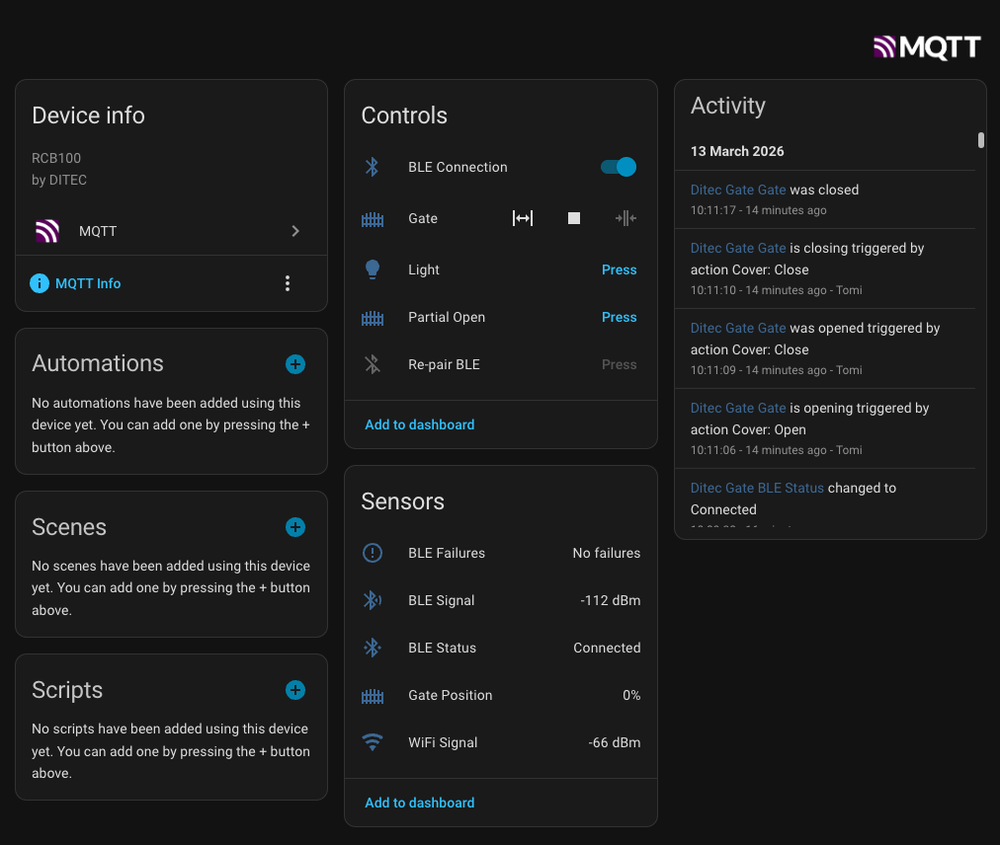

# Ditec ION4 / ION6 Gate — Home Assistant Integration via ESP32



Connect your **Ditec ION4B or ION6B** sliding gate to **Home Assistant** using an ESP32 as a permanent BLE-to-MQTT bridge. No cloud, no subscription — local control with full position tracking, auto-discovery, and MQTT.

```
Ditec ION4 / ION6 ←──BLE──→ ESP32 ←──WiFi/MQTT──→ Home Assistant
```

Works with any Ditec gate equipped with the **RCB100 BLE module** (ION4B, ION6B, and compatible models). The gate appears as a native Home Assistant `cover` entity with open/close/stop, live position percentage, and all device attributes.

## What You Get

Once set up, four entities appear automatically in Home Assistant under a single **Ditec Gate** device — no YAML required:

| Entity | Type | Description |
|---|---|---|
| **Gate** | Cover | Open, Close, Stop with live position (0–100%) and state |
| **Light** | Button | Toggle the courtesy light |
| **Partial Open** | Button | Open to the configured partial percentage |
| **BLE Connection** | Switch | Enable/disable the ESP32's BLE connection to the gate |

Device attributes available on the cover entity: manufacturer, model, firmware version, BLE MAC, board info, operation counter, auto-close settings, WiFi RSSI, BLE RSSI.

## Requirements

- An ESP32 board with BLE (ESP32, ESP32-S3, ESP32-C3, or any variant)
- A Ditec ION4 or ION6 gate with RCB100 BLE module, initialised via the **Ditec Gate Connect** app (see Setup below)
- An MQTT broker reachable from the ESP32 and Home Assistant (e.g. Mosquitto add-on)
- [PlatformIO](https://platformio.org/) to build and flash the firmware

## Setup

### 1. Initialise the Gate with the Ditec Gate Connect App

The gate starts in **temporary (unauthenticated) BLE access** mode — you must use the **Ditec Gate Connect** app to upgrade it to PIN-based authentication before the ESP32 can connect.

1. **Enable temporary access**: Press the physical button on the gate motor. This opens a ~13-hour enrollment window during which the gate accepts unauthenticated connections.
2. **Open Ditec Gate Connect** and connect to the gate. The app detects it in temporary-access mode.
3. **Set a PIN** in the app. This upgrades the gate to PIN-protected BLE Secure Connections (LE SC). Write the PIN down — you will need it for the ESP32.
4. **Disable temporary access** in the app once the PIN is set, if it doesn't do so automatically.

After this step the gate only accepts connections from devices that know the PIN.

### 2. Configure Credentials

Copy the credentials template and fill in your values:

```bash
cp src/credentials.h.example src/credentials.h
```

Edit `src/credentials.h`:

```cpp
#define WIFI_SSID       "YourWiFiNetwork"
#define WIFI_PASS       "YourWiFiPassword"

#define MQTT_HOST       "192.168.1.100"   // Your HA / MQTT broker IP
#define MQTT_PORT       1883
#define MQTT_USER       "mqtt"
#define MQTT_PASS       "mqtt_password"

#define GATE_BLE_ADDR   "00:60:37:XX:XX:XX"  // Gate's BLE MAC (Ditec Gate Connect app → Info)
#define GATE_PIN        123456                // Your 6-digit PIN (as integer)
```

`src/credentials.h` is gitignored and will never be committed.

### 3. Flash the ESP32

```bash
cd ditec_esp32

# Build and upload
pio run -t upload

# Monitor serial output (optional, for debugging)
pio device monitor
```

On first boot you should see:

```
=== Ditec Gate ESP32 Bridge ===

[WiFi] Connected: 192.168.1.50
[MQTT] Connected
[BLE] Initialized
[BLE] GATT server started
[BLE] Connecting to 00:60:37:XX:XX:XX...
[BLE] Connected! MTU=247
[BLE] Device: DITEC RCB100E (HW:003 FW:1.1.00)
[BLE] Board: HW 48 Rev.7 FW 1.1.0 MAC 00:60:37:XX:XX:XX
[MQTT] Discovery published
```

### 4. Add to Home Assistant

1. Go to **Settings → Devices & Services → MQTT**
2. A **Ditec Gate** device appears automatically with four entities
3. Open the gate cover entity — live position and state update in real time

## Signal Strength

To avoid intermittent disconnects, make sure both **BLE** and **WiFi** signals are strong at the ESP32's location:

- **BLE**: Place the ESP32 within clear line-of-sight of the gate motor. Thick concrete walls or metal enclosures significantly attenuate the 2.4 GHz BLE signal. A poor BLE link causes frequent supervision-timeout disconnects (HCI error 0x08).
- **WiFi**: A weak WiFi signal causes MQTT drops, making the gate appear offline in HA even when BLE is fine.

The serial monitor shows BLE RSSI on each poll cycle. Aim for above −75 dBm for a stable link.

## BLE Connection Toggle

The **BLE Connection** switch lets you control whether the ESP32 maintains a connection to the gate:

- **ON** (default): ESP32 connects to the gate and polls for status continuously
- **OFF**: ESP32 disconnects from the gate

You can toggle this from the HA UI, automations, or scripts.

## Re-pairing

If you ever need to re-pair (e.g. after changing the PIN on the gate):

1. Turn off the **BLE Connection** switch so the ESP32 disconnects from the gate.
2. Press the **Re-pair** button — it clears the stored bond and resets the connection attempt counter.
3. Turn the **BLE Connection** switch back on — the ESP32 will connect and go through the full pairing handshake using the PIN in `credentials.h`.

The Re-pair button is only available in HA while the ESP32 is not actively connected (it is greyed out when a BLE connection is live). This is enforced by the firmware.

## Status Mapping

| Gate State | HA Cover State | Description |
|---|---|---|
| Closed | `closed` | Fully closed, idle |
| Open | `open` | Fully open, idle |
| Partial Open | `open` | Partially open, idle |
| Opening | `opening` | Motor running, opening |
| Closing | `closing` | Motor running, closing |
| Stopped | `stopped` | Stopped mid-travel |
| IR Reversing | `opening` | Safety reverse (IR beam broken while closing) |
| Transitioning | `opening` | Momentary direction change |
| Error | `stopped` | Error state |

## Troubleshooting

### ESP32 can't connect to the gate

- Make sure the gate PIN has been set via the **Ditec Gate Connect** app (see Setup step 1).
- Verify the BLE MAC address in `credentials.h` is correct (Ditec Gate Connect app → Info screen).
- Check the serial monitor for connection attempts and error codes.

### Pairing fails

- Double-check the PIN in `credentials.h` matches what you set in the **Ditec Gate Connect** app.
- If the ESP32 was previously bonded with a different PIN, disable the BLE Connection switch, then press **Re-pair** in HA to clear the bond and start fresh.

### Gate appears offline in Home Assistant

- Check the ESP32 is connected to WiFi (serial monitor).
- Check the MQTT broker is running and reachable.
- Listen to MQTT traffic: **Settings → Devices & Services → MQTT → Configure → Listen to topic** → enter `ditec/#`.

### Position percentage looks wrong or erratic

After a power cycle the gate loses its calibration and doesn't know its position in the travel range. The reported percentage will be invalid until recalibrated. Run a full open followed by a full close — the gate recalibrates during travel and position will read correctly after that.

### Frequent disconnects

- Check BLE and WiFi signal strength at the ESP32's location (see Signal Strength section above).
- The ESP32 auto-reconnects with exponential backoff after a disconnect — check the serial monitor for the disconnect reason code.
